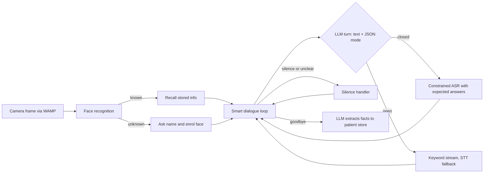

# Mini: a social robot companion for aphasia therapy

A Python application for the **Alpha Mini** social robot that holds short, patient-paced conversations with people with aphasia. The robot recognises returning patients by face, remembers what they shared in earlier sessions, and uses an LLM to keep the dialogue simple, warm and adapted to how well the patient is able to answer.

Developed as a group project for the Human-Robot Interaction course at the University of Groningen. This is a cleaned-up showcase copy of the [original team repository](https://github.com/dogaturak/HRI), with full commit history and authorship preserved. Test photos, patient data files and credentials were removed from the history for privacy.

## Why this is hard

People with aphasia often answer slowly, partially, or not at all, and off-the-shelf speech recognition struggles with them. A naive "LLM plus speech-to-text" loop breaks quickly: the robot interrupts, misreads short answers, or asks questions the patient cannot follow. Most of the engineering here goes into controlling *what the model sees and what the robot listens for* on every turn.

## How it works



A session runs in four phases: face recognition, a personalised introduction, the main dialogue, and a farewell where the conversation is distilled into structured patient information for the next visit.

### LLM harness (smart dialogue)

The dialogue layer treats the LLM as one component in a real-time control loop rather than a chatbot.

**Structured turns.** Every reply from the main model ends with a single JSON line declaring how the robot should listen next. A *closed* turn lists every expected answer together with likely speech-recognition sound-alikes, which is passed to the robot's constrained ASR. An *open* turn lists the 3 to 6 words the patient is most likely to say, which drives a keyword listener with a free speech-to-text fallback. A parser separates spoken text from metadata and degrades gracefully to a fallback mode when the model breaks format.

**Model routing by task.** Three Gemini sessions are matched to task complexity: a Pro model for the main dialogue and JSON annotation, a Flash model for introductions and information extraction, and a Flash-Lite model for quick reassurance when the patient goes silent or is unclear.

**Real-time context.** Recognition results, stored patient facts and the last conversation topic are injected into the conversation as it happens, so the model always works with relevant and current context instead of a static prompt.

**Robustness.** Silence detection with escalating comfort phrases, validation and sanitisation of the model's answer sets before they reach the ASR, exponential back-off on API overload, and explicit exit words.

## Repository layout

| Folder | Contents |
|---|---|
| `smart_dialogue/` | The integrated application: session orchestration, LLM client, dialogue and listening modes, silence handling, face and patient stores |
| `main/` | Earlier main implementation |
| `face_recognition/` | Standalone face recognition and enrolment |

## Running it

Requires access to an Alpha Mini robot through the RUG robot server and the course-provided `alpha_mini_rug` package, which is not on PyPI.

```bash
python3 -m venv .venv
source .venv/bin/activate
pip install -r requirements.txt
export GEMINI_API_KEY=your_key_here
export WAMP_REALM=your_robot_realm
python smart_dialogue/main.py
```

Settings such as model choice, silence timing and face-match threshold live in `smart_dialogue/config.py`. Design flowcharts are available on [Whimsical](https://whimsical.com/social-robotics/RxsuyhPwKjypegiAbzkj6B).

## Team

| Member | Main contributions |
|---|---|
| Óscar Ferrer Domingo ([@oscatec](https://github.com/oscatec)) | Gemini API integration and the full smart dialogue implementation, including the LLM harness: structured turns, model routing and real-time context handling |
| Martijn Schippers ([@MartijnSchippers](https://github.com/MartijnSchippers)) | Face recognition software and face information database |
| Doga Turak ([@dogaturak](https://github.com/dogaturak)) | Silence handleling and integrated games for optional integration |
| Gian Fuschi ([@GianFuschi](https://github.com/GianFuschi)) | Patient profile building and main code cohesiveness |

**Stack:** Python, Google Gemini API, Autobahn / Twisted (WAMP), OpenCV, NumPy
